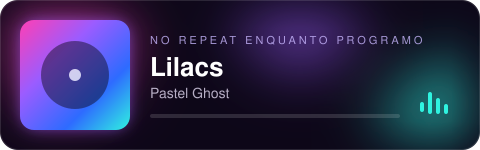

<!-- Cabeçalho animado no tema Lilacs -->

<!-- Digitação animada -->

 

## Sobre mim

<table><tr><td width="500">

Sou um desenvolvedor apaixonado por tecnologia, **software** e **desenvolvimento de jogos**. Minha jornada começou com **hardware**, manutenção de computadores e sistemas operacionais **Linux** e **Windows**, e evoluiu para o desenvolvimento de software e projetos autorais.

Atualmente estudo **Tecnologia da Informação** no SEG (Sistema de Ensino Gaúcho) e dedico meu tempo a aprimorar habilidades através de projetos práticos, com foco especial em **C#** e **GameMaker Language (GML)**.

- Background sólido em hardware e infraestrutura
- Entusiasta de game development com GameMaker
- Criando wallpapers animados com HTML, CSS e JavaScript
- Sempre aprendendo e explorando novas tecnologias
- Trilha sonora de quase todo código, **Pastel Ghost**
- Rio Grande do Sul, Brasil

</td></tr></table>

## Projeto em destaque

<table>
  <tr>
    <td width="58%" valign="top">
      
    </td>
    <td valign="top">

### [Lilacs Wallpaper](https://github.com/EduardoHolkem/Lilacs-Wallpaper)

Wallpaper animado inspirado em *Lilacs*, do Pastel Ghost, para **Wallpaper Engine** e **Lively**.

Fundo de quatro cores, fantasmas espelhados em neon, halo de luz RGB, glitch e estética VHS. Ele ainda mostra a música que está tocando no Spotify ou no YouTube Music, com a letra sincronizada.

    </td>
  </tr>
</table>

<table>
  <tr>
    <td valign="top">
      
    </td>
    <td valign="top">
      
    </td>
  </tr>
</table>

## Linguagens e tecnologias

&nbsp;
&nbsp;
&nbsp;
&nbsp;
&nbsp;
&nbsp;
&nbsp;
&nbsp;

 

## Tocando agora

 
dream pop, synth e neon. É isso que toca enquanto o código compila.

 

Se algum projeto te ajudou, considera deixar uma estrela. É o combustível do desenvolvedor.

