 

## Sobre mim

Sou um desenvolvedor apaixonado por tecnologia, **software** e **desenvolvimento de jogos**. Minha jornada começou com **hardware**, manutenção de computadores e sistemas operacionais **Linux** e **Windows**, e evoluiu para o desenvolvimento de software e projetos autorais.

Atualmente estudo **Tecnologia da Informação** no SEG (Sistema de Ensino Gaúcho) e dedico meu tempo a aprimorar habilidades através de projetos práticos, com foco especial em **C#** e **GameMaker Language (GML)**.

- Background sólido em hardware e infraestrutura
- Entusiasta de game development com GameMaker
- Criando wallpapers animados com HTML, CSS e JavaScript
- Sempre aprendendo e explorando novas tecnologias
- Trilha sonora de quase todo código, **Pastel Ghost**
- Rio Grande do Sul, Brasil

## Projeto em destaque

<table>
  <tr>
    <td width="58%" valign="top">
      
    </td>
    <td valign="top">
      <h3><a href="https://github.com/EduardoHolkem/Lilacs-Wallpaper">Lilacs Wallpaper</a></h3>
      
Wallpaper animado inspirado em <i>Lilacs</i>, do Pastel Ghost, para <b>Wallpaper Engine</b> e <b>Lively</b>.

      
Fundo de quatro cores, fantasmas espelhados em neon, halo de luz RGB, glitch e estética VHS. Ele ainda mostra a música que está tocando no Spotify ou no YouTube Music, com a letra sincronizada.

      

        
        
      

      
    </td>
  </tr>
</table>

## Linguagens e tecnologias

  &nbsp;
  &nbsp;
  &nbsp;
  &nbsp;
  &nbsp;
  &nbsp;
  &nbsp;
  &nbsp;
  

 

  
   
  Se algum projeto te ajudou, considera deixar uma estrela. É o combustível do desenvolvedor.

